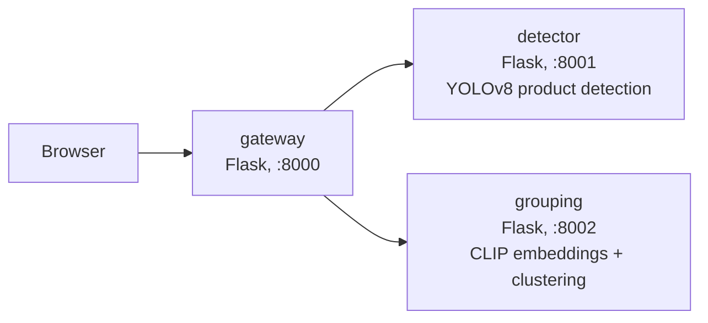

# Product Shelf Detection & Brand Grouping Pipeline

A three-service AI pipeline. Upload a retail shelf image, get back
bounding boxes for every product, a brand-group id per product, and a
color-coded visualization image saved to disk.



- **gateway**: the only service the browser talks to. Calls detector then
  grouping over HTTP, draws the visualization, saves it to `outputs/`,
  returns the combined JSON.
- **detector**: loads a YOLOv8 shelf-product model once at startup,
  exposes `POST /detect`. Output goes through post-processing
  (`detector/postprocess.py`, see below).
- **grouping**: loads a CLIP image encoder once at startup, embeds each
  crop, clusters with agglomerative clustering (cosine distance, cluster
  count not fixed). Exposes `POST /group`.

Services talk only over HTTP via env-configured URLs — no hardcoded
paths, no shared filesystem.

## 1. Setup

Requires Python 3.12. Model weights, HF/torch caches, and pip cache all
live under `STORAGE_ROOT` (set in `.env`), not `~/.cache`.

**1.1 Copy the example env file** (`.env` is machine-specific, never
committed/shared):

```bash
cp .env.example .env
```

`STORAGE_ROOT` defaults to `$(pwd)/storage`, resolved once when `.env` is
sourced — so always source it from the repo root (services start with
`gunicorn --chdir <service>`, which would otherwise turn a relative path
into `<service>/storage` instead of the repo's).

**1.2 Create the storage layout and virtual environment:**

```bash
set -a && source .env && set +a
mkdir -p "$STORAGE_ROOT"/{datasets,weights,hf_cache,torch_cache,runs,tmp,pip_cache}

uv venv --python 3.12 .venv
uv pip install --python .venv \
    -r detector/requirements.txt -r grouping/requirements.txt -r gateway/requirements.txt \
    --extra-index-url https://download.pytorch.org/whl/cpu \
    --index-strategy unsafe-best-match
```

(`--extra-index-url` pulls the CPU-only `torch` wheel. `--index-strategy
unsafe-best-match` is needed since some packages are newer on PyPI than
on PyTorch's index mirrors.)

Don't have `uv`? Plain `venv` + `pip` works the same way:

```bash
set -a && source .env && set +a
mkdir -p "$STORAGE_ROOT"/{datasets,weights,hf_cache,torch_cache,runs,tmp,pip_cache}

python3.12 -m venv .venv
source .venv/bin/activate
pip install \
    -r detector/requirements.txt -r grouping/requirements.txt -r gateway/requirements.txt \
    --extra-index-url https://download.pytorch.org/whl/cpu
deactivate
```

Everything downstream (`.venv/bin/gunicorn`, `.venv/bin/python`, ...)
works the same regardless of which one created the venv — no need to
keep the venv activated for the rest of the setup.

**1.3 Get the detector weights.** `DETECTOR_MODEL` in `.env.example`
points to `$STORAGE_ROOT/weights/yolov8n_sku.pt` (see WRITEUP.md for why
this checkpoint was picked). It's required — the detector refuses to
start if it's unset or missing, rather than silently using a different
model.

git-lfs must be installed first, otherwise the clone below only fetches
an LFS pointer, not the real weights:

```bash
# Debian/Ubuntu
sudo apt-get install git-lfs
# macOS (Homebrew)
brew install git-lfs
git lfs install
```

Then download the weights:

```bash
git clone --depth 1 https://github.com/samusafe/YOLOv8.git /tmp/yolov8n_sku_src
cp /tmp/yolov8n_sku_src/submissao/modelos/yolov8n_sku/weights.pt "$STORAGE_ROOT/weights/yolov8n_sku.pt"
rm -rf /tmp/yolov8n_sku_src
```

You can also point `DETECTOR_MODEL` at a Hugging Face repo id instead,
and it will auto-download (no git-lfs needed).

**1.4 Start all three services**, from the repo root, under gunicorn —
this gives each service multiple worker processes for concurrent
requests, instead of Flask's single-threaded dev server queuing them.

> Gunicorn runs in the foreground. Pasting these as three separate
> commands into one terminal only starts the first (detector) — it
> blocks the terminal, so grouping/gateway never run. Either use separate
> terminal tabs, or background all three like below:

```bash
set -a && source .env && set +a
.venv/bin/gunicorn --chdir detector -w 2 --timeout 120 -b 0.0.0.0:8001 app:app > /tmp/detector.log 2>&1 &
.venv/bin/gunicorn --chdir grouping -w 2 --timeout 120 -b 0.0.0.0:8002 app:app > /tmp/grouping.log 2>&1 &
.venv/bin/gunicorn --chdir gateway  -w 4 --timeout 120 -b 0.0.0.0:8000 app:app > /tmp/gateway.log 2>&1 &
```

Check `tail -f /tmp/detector.log /tmp/grouping.log /tmp/gateway.log` for
startup progress, and `pkill -f gunicorn` to stop all three.

`-w 2` for detector/grouping (each worker loads its own model copy —
don't exceed your RAM/CPU cores), `-w 4` for gateway (no inference, cheap
to replicate). `--timeout 120` covers first-request model warmup.

For local debugging only (auto-reload, one request at a time):

```bash
set -a && source .env && set +a
.venv/bin/python detector/app.py    # :8001
.venv/bin/python grouping/app.py    # :8002
.venv/bin/python gateway/app.py     # :8000
```

**1.5 Try it.** Open http://localhost:8000, or call the API directly:

```bash
curl -X POST http://localhost:8000/api/analyze -F "image=@sample_images/128008.jpg"
```

## 2. Detector post-processing

`detector/app.py` runs two steps between raw YOLO output and the
`/detect` response:

1. **Dedupe / containment filter** (`DETECTOR_DEDUPE_ENABLED`,
   `DETECTOR_CONTAINMENT_IOU`) — drops a box mostly contained inside a
   bigger one, catching cases where one product gets split into 2-3
   overlapping boxes. Different from YOLO's own IoU-based NMS, which can
   miss nested boxes with low IoU.
2. **Price-tag filtering** (`DETECTOR_PRICE_TAG_METHOD` = `none` |
   `geometry` | `clip`) — meant to drop shelf price tags detected as
   products. Defaults to `none`; see WRITEUP.md for why.

Set `DETECTOR_DEBUG_SAVE=true` to save `<name>_<id>_before.jpg` /
`_after.jpg` pairs to `DETECTOR_DEBUG_DIR` (default `outputs/debug/`) for
every `/detect` call.

## 3. Scripts

```bash
# Sends every image in sample_images/ through the pipeline, saves per-image
# JSON results to outputs/results/, and prints a summary table.
.venv/bin/python scripts/run_samples.py
```

## 4. API

### `POST /api/analyze`

Request: multipart form, field `image` (jpg/png).

Response:

```json
{
  "request_id": "da8c952739a8",
  "image_size": {"w": 1080, "h": 1920},
  "num_products": 113,
  "num_groups": 4,
  "products": [
    {"id": "P1", "bbox": [511.9, 1218.7, 687.5, 1431.6], "score": 0.9203, "group_id": "G1"}
  ],
  "groups": [
    {"group_id": "G1", "color": "#f22424", "count": 42}
  ],
  "latency_ms": {"detect": 311.52, "group": 2386.73, "total": 2749.62},
  "visualization_url": "/outputs/da8c952739a8.jpg"
}
```

### Internal service contracts

`POST detector:8001/detect` — form field `image` gives back:
`{"boxes": [{"bbox": [x1,y1,x2,y2], "score": 0.92}, ...], "latency_ms": 12.3, "image_size": {"w":.., "h":..}}`

`POST grouping:8002/group` — form fields `image` and `boxes` (JSON array
of the boxes above) gives back: `{"groups": ["G1", "G2", ...], "latency_ms": 45.6}`
(same order and length as the input boxes).

Both services also expose `GET /health`. The detector's also reports the
loaded model — `{"status": "ok", "model": "/path/to/yolov8n_sku.pt"}` —
so you can confirm it isn't serving from the wrong one.

## 5. Configuration

Everything is env-configured via `.env.example`: storage/cache paths,
detector model path/confidence/IoU/imgsz/post-processing thresholds,
grouping model and clustering threshold, service URLs, upload limit,
timeouts. `DETECTOR_MODEL` has no default — the detector refuses to
start rather than silently falling back to a different model.

## 6. Benchmark results

Measured locally on CPU, single machine, models warm. 20 requests at
concurrency 4, same image (`128008.jpg`, 113 products):

| metric | value |
|---|---|
| succeeded / failed | 20 / 0 |
| p50 latency | 6641 ms |
| p95 latency | 6774 ms |
| throughput | 0.60 req/s |

Measured against Flask's dev server (single-threaded, so concurrent
requests queue) — hence the gunicorn setup above. Latency is driven
mainly by product count, not image size: detection cost stays roughly
constant (~60-135ms), but grouping scales with box count (~500ms for 25
products, ~5s for 240). See `scripts/run_samples.py` output or
`outputs/results/*.json` for per-image breakdowns.

See `WRITEUP.md` for design reasoning, alternatives considered, sample
visualizations, and the scaling discussion.
