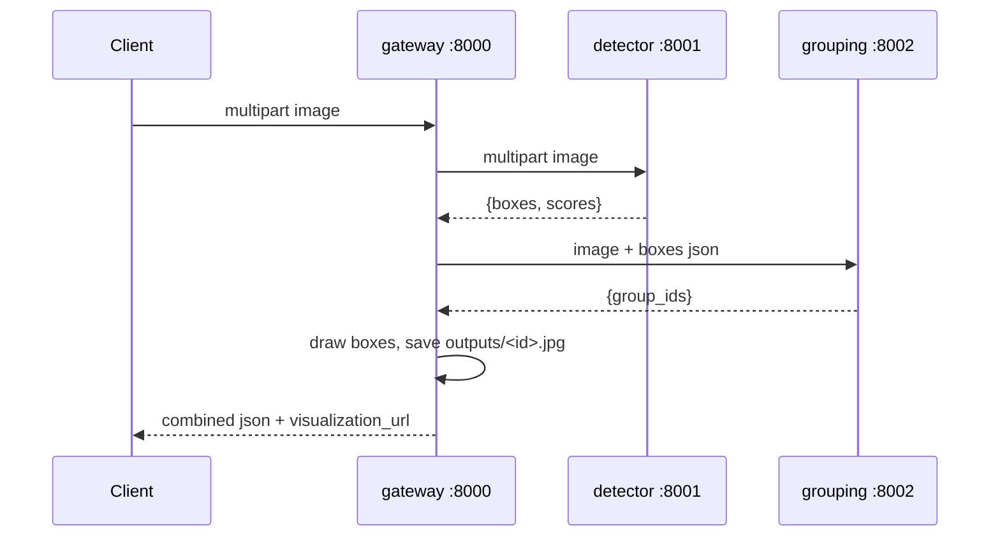
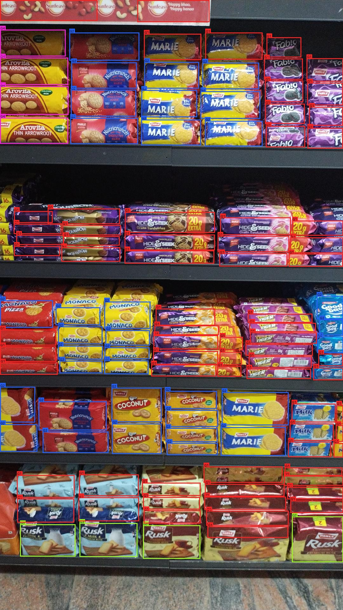
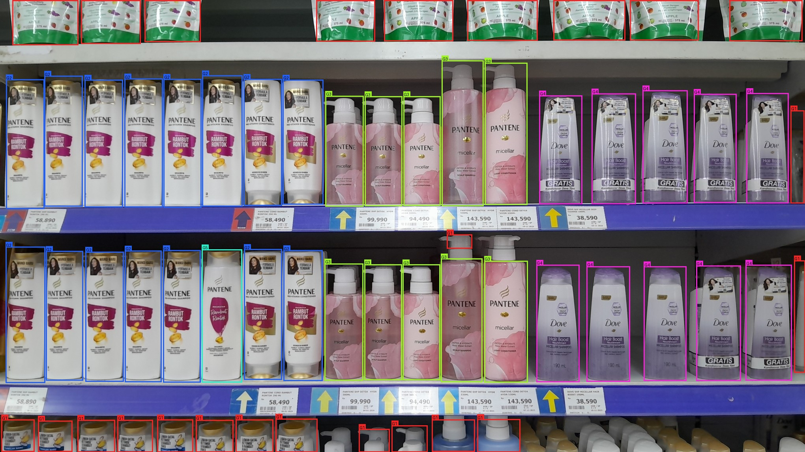
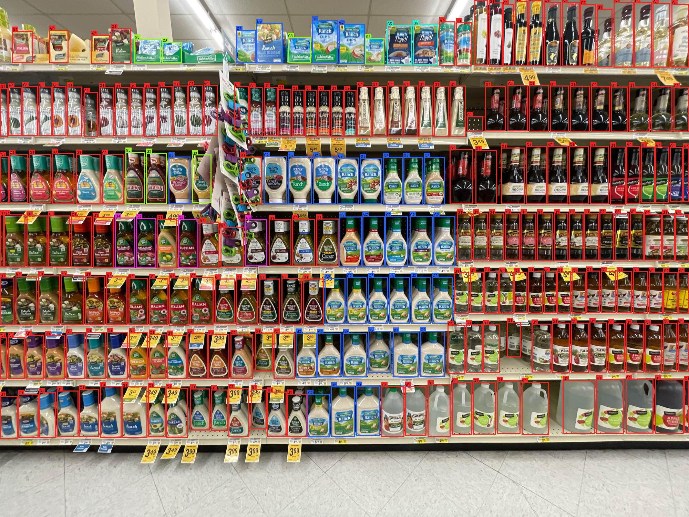
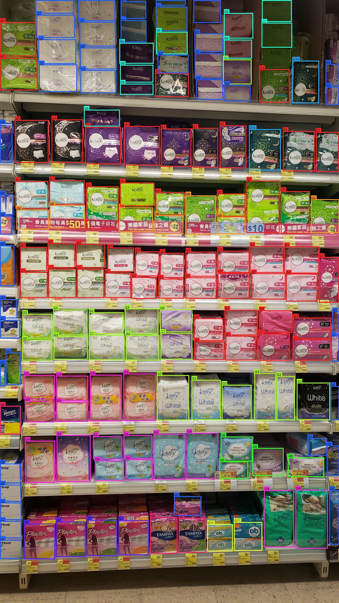
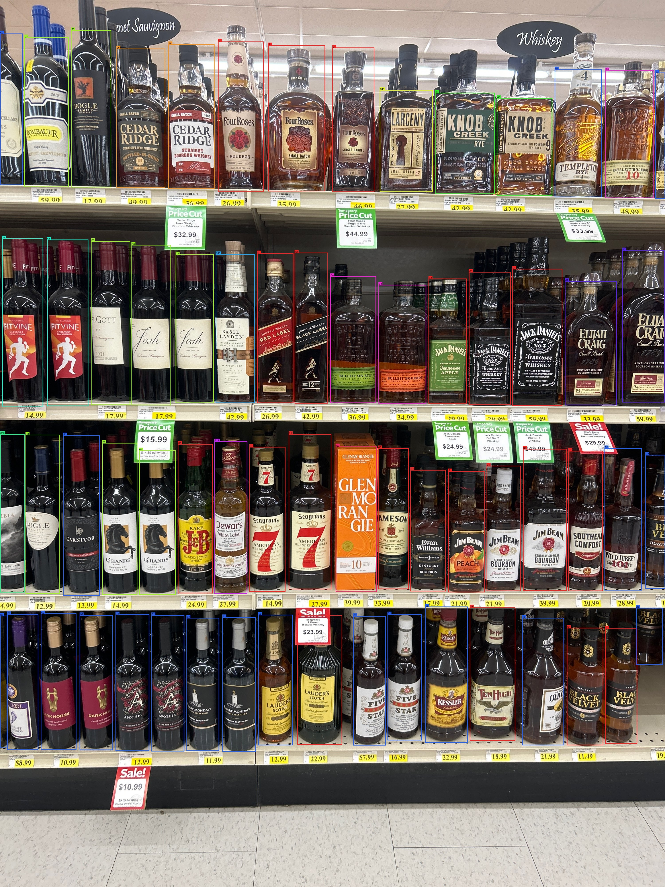

# Write-up: Product Detection & Brand Grouping Pipeline

## 1. Problem

Given a retail shelf image, detect every product, assign each one a group
id so that products of the same brand share a group, and return this as
JSON with boxes and group ids plus a color-coded visualization image.

## 2. Architecture

Three independent Flask microservices, talking only over HTTP via
env-configured URLs. No hardcoded paths, no shared filesystem:



Splitting into three services lets detection and grouping scale
independently — they have very different compute profiles (detection is
fixed-cost, grouping scales with box count) and could even run on
different hardware (e.g. GPU for detector, CPU for grouping).

## 3. Model choices

### 3.1 Detection: YOLOv8-nano fine-tuned on real SKU-110K (`yolov8n_sku`)

`yolov8n_sku`, from
[github.com/samusafe/YOLOv8](https://github.com/samusafe/YOLOv8)
(`submissao/modelos/yolov8n_sku`) — YOLOv8-nano fine-tuned on the real
SKU-110K dataset (11,762 dense shelf images, single class `"item"`,
mAP@0.5=0.90). It boxes individual product facings rather than whole
multi-pack stacks, and is small (6MB) and fast on CPU.

Why YOLOv8: single-class detection needs no per-SKU classification (that's
grouping's job), and it's fast on CPU compared to two-stage detectors —
important given no guaranteed GPU.

**Alternatives considered:**
- *Generic YOLOv8n/COCO* — not tuned for dense shelf scenes; would still
  need SKU-110K fine-tuning.
- *Faster R-CNN / DETR* — better precision on small/overlapping objects,
  but 3-5x slower on CPU.
- *Classical edge/contour detection* — fast, no model, but fails with
  varied lighting/packaging and needs heavy per-store tuning.
- *Training a checkpoint from scratch* — kept as a fallback, never needed
  once `yolov8n_sku` proved good enough on inspection.

### 3.2 Detector post-processing (dedupe + price-tag filtering)

`detector/postprocess.py` fixes two issues found in `yolov8n_sku`'s raw
output:

**Duplicate/nested boxes** — the same product sometimes gets boxed 2-3
times (e.g. top-half, bottom-half, and full-pack). YOLO's IoU-based NMS
misses this because a small box fully inside a big one can have low IoU.
Fix: a containment check — sort boxes by area, drop a smaller box if its
overlap with an already-kept larger box exceeds `DETECTOR_CONTAINMENT_IOU`
(default 0.7) of its own area. Verified visually on sample images that
this doesn't merge genuinely separate stacked products.

**Price-tag filtering** (`DETECTOR_PRICE_TAG_METHOD`) — meant to drop
shelf price labels wrongly detected as products. Two methods were tried
and both removed real products without a confirmed price-tag false
positive to justify it: geometry (aspect ratio + height threshold) removed
86 boxes (4.4%), CLIP zero-shot removed 726 boxes (37%) and added ~2.8s
per image. Defaults to `none`; both methods remain available behind the
env var if a real repro case shows up.

### 3.3 Grouping: CLIP embeddings + agglomerative clustering

Each detected box is cropped, embedded with CLIP
(`openai/clip-vit-base-patch32`), L2-normalized, then clustered per-image
with agglomerative clustering (cosine distance, `distance_threshold=0.3`,
`n_clusters=None`).

Why: CLIP embeddings capture visual similarity (color, packaging, logo)
zero-shot, with no brand-specific training needed — important since there's
no labeled brand dataset for arbitrary products. Agglomerative clustering
with no fixed `n_clusters` fits because the number of brand groups per
shelf is unknown and varies. Cosine distance matches how CLIP is trained.

**Alternatives considered:**
- *DBSCAN* — also doesn't need k upfront, but marks sparse groups as noise
  instead of assigning a group id, which doesn't fit the requirement.
- *K-means* — needs a known/guessed cluster count, which isn't available.
- *Fine-tuned brand classifier* — more accurate for a fixed catalog, but
  doesn't generalize to unseen brands.
- *OCR on packaging text* — could help disambiguate similar packaging, but
  adds a whole extra pipeline stage; left as a possible future addition.

### 3.4 Visualization

Each group gets a deterministic color via golden-ratio HSV hue spacing
(`gateway/visualize.py`), so colors stay visually distinct regardless of
group count. Boxes are labeled with their group id.

## 4. Sample output visualizations

Actual outputs from this pipeline (`outputs/`, generated by
`scripts/run_samples.py`):

1. `sample_images/128008.jpg` — 113 products, 4 groups
   
2. `sample_images/2024_01_16_1705384430514.jpg` — 60 products, 5 groups
   
3. `sample_images/Good Quality-1993_8.jpg` — 240 products, 5 groups
   
4. `sample_images/IMG__2019-12-11_145604.jpg` — 154 products, 11 groups
   
5. `sample_images/observa_2023_11_02_07_16_47_1698909407_9007626.jpg` — 65 products, 13 groups
   

## 5. Input/Output format

**Client-facing** (`POST /api/analyze`, multipart form field `image`):

```json
{
  "request_id": "da8c952739a8",
  "image_size": {"w": 1080, "h": 1920},
  "num_products": 113,
  "num_groups": 4,
  "products": [
    {"id": "P1", "bbox": [511.9, 1218.7, 687.5, 1431.6], "score": 0.9203, "group_id": "G1"}
  ],
  "groups": [{"group_id": "G1", "color": "#f22424", "count": 42}],
  "latency_ms": {"detect": 311.52, "group": 2386.73, "total": 2749.62},
  "visualization_url": "/outputs/da8c952739a8.jpg"
}
```

**detector** (`POST /detect`): raw image in → `{bbox, score}` list plus
latency and image dimensions.

**grouping** (`POST /group`): raw image + detector's `boxes` JSON in →
`group_ids` array (same order/length as input boxes) plus latency. Boxes
are passed in rather than re-detected, keeping a clean service boundary.

## 6. Latency and scaling

Measured locally (CPU only, models warm — see README for exact numbers):
p50 ~6.6s, p95 ~6.8s, ~0.6 req/s at concurrency 4, on an image with 113
products.

Latency is driven mainly by **product count**, not image size. Detection
cost is roughly constant (~60-135ms at `imgsz=1024`) regardless of box
count, but grouping's CLIP forward pass scales with crop count — a
240-product shelf takes ~5s in grouping alone, vs. under 500ms for a
25-product shelf. Flask's dev server is also single-threaded, so
concurrent requests queue instead of running in parallel.

Next steps for scale (not implemented, out of scope here):

1. **Gunicorn with multiple workers** instead of Flask's dev server —
   already wired into the README's run instructions.
2. **Batch grouping crops** — already batched into one CLIP forward pass
   per request; further gains from smaller crop resolution or a lighter
   CLIP variant if grouping becomes the bottleneck.
3. **Horizontal scaling** — detector/grouping are stateless, so each can
   be replicated independently based on its own load.
4. **GPU** — both YOLOv8 and CLIP would speed up significantly; the code
   already checks `torch.cuda.is_available()`.
5. **Caching** — a request-level cache keyed on image hash would help for
   duplicate uploads (e.g. client retries).
